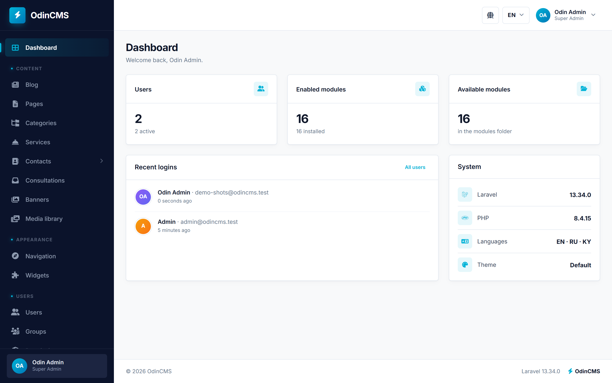
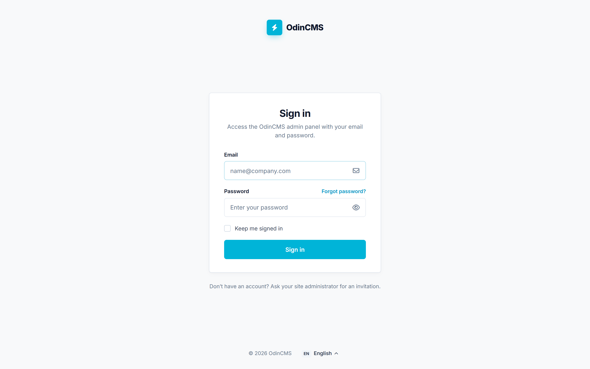

# OdinCMS

A modular CMS on Laravel 13. Every feature (users, blog, pages, menus, widgets, …) is a **module**
in `modules/` that can be installed, enabled, disabled and uninstalled from the admin panel.



<details>
<summary>Sign-in page</summary>



</details>

## Features

- Admin panel at `/admin`, built on our own OdinAdmin template (`public/odinadmin`)
- Content in several languages (en, ru, ky by default) with `/ru/…` URLs
- Groups and permissions (spatie/laravel-permission), two-factor login (Fortify)
- Core modules: Users, Groups, Permissions, Modules, Settings, Navigation, Widgets, Categories, Blog,
  Pages, Media library
- Optional modules: Services, Banners, Sections, Contacts, Consultations
- `php artisan cms:make:module` scaffolds a new module with CRUD, translations and a test

## Requirements

- PHP 8.4 with `pdo_mysql`, `mbstring`, `intl`, `gd` (or `imagick`), `fileinfo`, `zip`
- MySQL 8.4 (the CMS uses JSON columns)
- Composer 2, Node.js 20+ and npm

## Installation

```bash
composer install
cp .env.example .env            # then set DB_DATABASE, DB_USERNAME, DB_PASSWORD
php artisan key:generate
npm ci && npm run build
php artisan storage:link        # uploaded images (avatars, covers)
php artisan cms:install         # migrations, core modules, the first super admin (asks for name, email, password)
php artisan serve               # http://localhost:8000, admin at http://localhost:8000/admin
```

`cms:install` options: `--name=`, `--email=`, `--password=` (avoid on shared machines: shell history),
`--no-admin` (create the super admin later by running `cms:install` again).

During development, `npm run dev` rebuilds the CSS and JS on change.

## Modules

```bash
php artisan cms:modules:sync              # find new or removed module folders
php artisan cms:module:install blog       # migrations + seeder + permissions, then enable
php artisan cms:module:enable blog
php artisan cms:module:disable blog       # routes, menu items and widgets disappear; data is kept
php artisan cms:module:upgrade blog       # run new migrations after a version bump
php artisan cms:module:uninstall blog     # roll back its migrations: its data is deleted
php artisan cms:make:module Tours         # a new module with CRUD, translations and a test
```

The same actions are in **Admin → Modules**. Core modules cannot be uninstalled; Blog, Categories and
Pages can be disabled. How to write a module: [docs/modules.md](docs/modules.md).

## Languages

The active languages and the default one are set in **Admin → Settings → Languages**. The default
language has no URL prefix (`/blog`), the others do (`/ru/blog`). Content without a translation shows
in the default language.

- Module texts: `modules/{Module}/Resources/lang/{en,ru,ky}/*.php`
- Core texts: `lang/{ru,ky}.json` (keys are the English text) and `lang/{locale}/cms.php`
- Laravel's own messages (validation, …): `lang/{ru,ky}/*.php`, from `laravel-lang/common`

`tests/Feature/Cms/TranslationsTest.php` fails when a text is missing in a language.

## Theme

The frontend theme is `resources/views/themes/default` (Bootstrap 5, `resources/css/theme.scss`):

- `layouts/app.blade.php`: header menu `@navigation('header')`, language switcher, footer widget areas
  `@widgetArea('footer-1')` … `footer-3`, footer menu `@navigation('footer')`
- `home.blade.php`: site name and tagline (Admin → Settings → Site), widget area `home-top`
- `pages/{layout}.blade.php`: page layouts (default, full-width, sidebar with the `sidebar` area);
  add a file here to offer a new layout
- `error.blade.php`: 403/404/419/429 pages (500 and 503 are plain, in `resources/views/errors`)

## Tests and code quality

```bash
composer test     # Pint (style), Larastan (static analysis), Pest (tests)
```

Tests use the MySQL database `odincms_test` (see `phpunit.xml`); create it once, empty.
Outside production, lazy loading of relations throws (`Model::preventLazyLoading()`), so N+1 queries
show up in the tests.

## Production

- Copy `.env.production.example` to `.env`: `APP_ENV=production`, `APP_DEBUG=false`, HTTPS URL,
  Redis for cache, sessions and queue, secure session cookies.
- Serve the site over HTTPS only. Point the web server at `public/`.
- Deploy:

  ```bash
  composer install --no-dev --optimize-autoloader
  npm ci && npm run build
  php artisan migrate --force
  php artisan optimize          # config, routes, views and events cached
  php artisan queue:work        # run under a supervisor (systemd, Supervisor)
  ```

- After changing `.env` or deploying code, run `php artisan optimize` again. Module actions in the
  admin clear the route cache themselves.
- Cropping uploaded photos with GD needs memory: the CMS raises `memory_limit` to 512M while it
  processes an image; allow that in php.ini (or install Imagick).
- Every response carries security headers (`App\Http\Middleware\SecurityHeaders`); HSTS is sent on
  HTTPS in production.

## Contributing

Bug reports and pull requests are welcome. Read [CONTRIBUTING.md](CONTRIBUTING.md) first. To report a
security problem, follow [SECURITY.md](SECURITY.md) and do not open a public issue.

## Contact

OdinZero: odinzeroofficial@gmail.com

## License

OdinCMS is open-source software under the [MIT license](LICENSE).

The OdinAdmin template in `public/odinadmin` is **not** MIT. You may use and change it as part of
OdinCMS, but you may not sell it or share it on its own: see
[public/odinadmin/LICENSE.md](public/odinadmin/LICENSE.md).

Third-party parts keep their own licenses, among them:

- Country flags in `public/flags`: [flag-icons](https://github.com/lipis/flag-icons) (MIT)
- [TinyMCE](https://www.tiny.cloud/) rich text editor (GPL-2.0-or-later, used with `license_key: 'gpl'`)
- Laravel, Bootstrap, Alpine.js, Font Awesome Free, Leaflet, Cropper.js, SortableJS and the spatie
  packages: see `composer.json` and `package.json`
